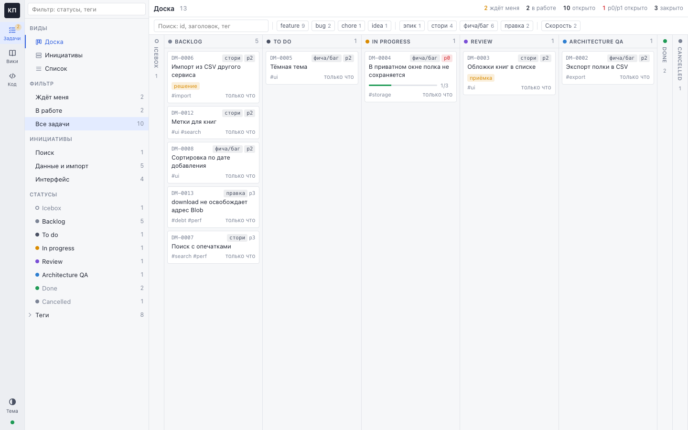
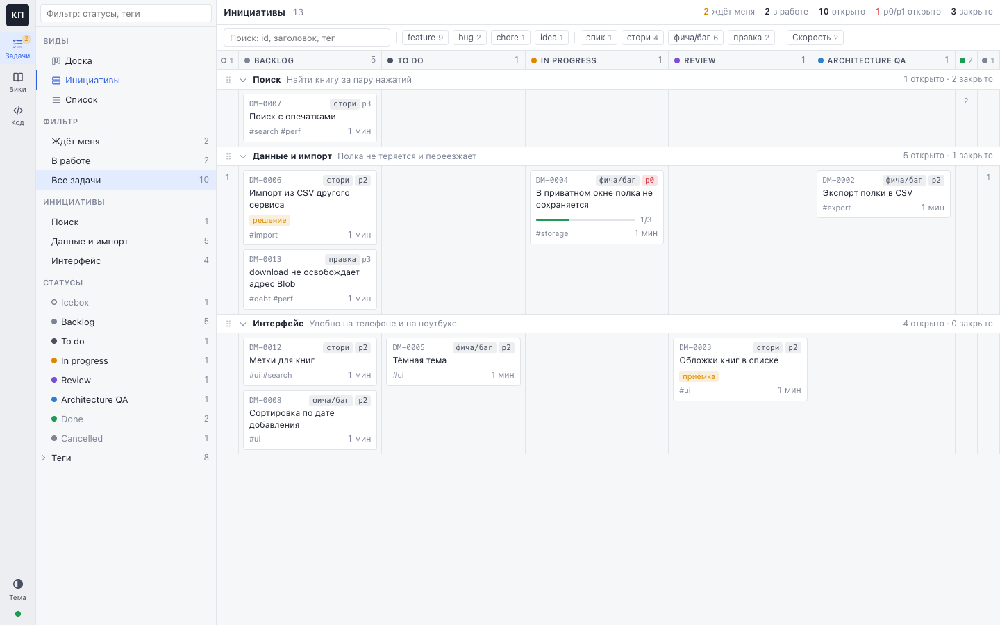
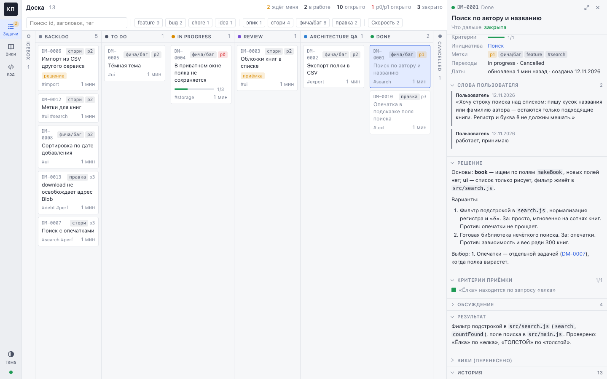
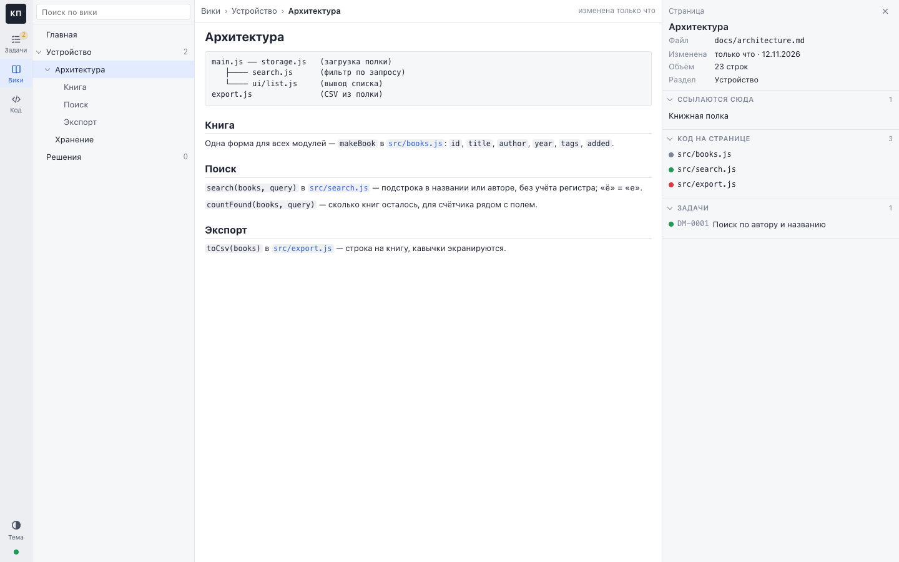
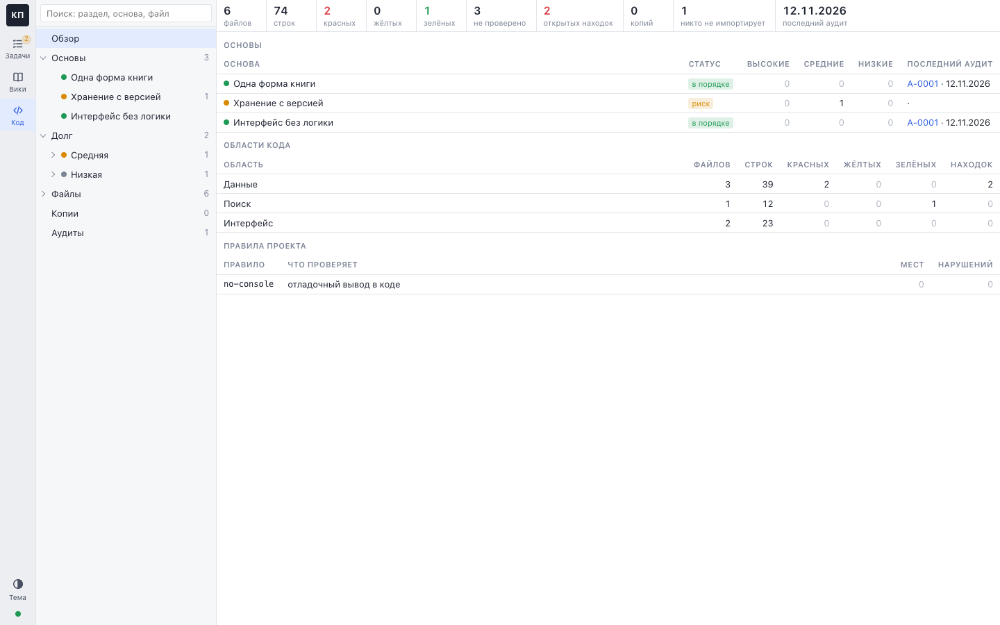
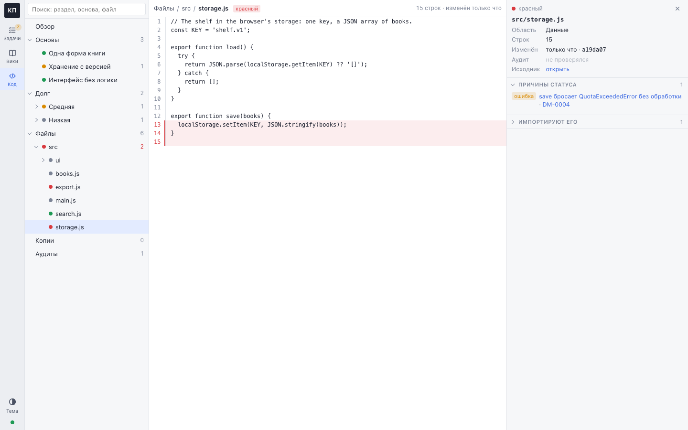

# agentic-task-tracker

Трекер задач, который живёт внутри проекта, в папке `.tasks/`, и рассчитан на работу с
агентом. Это скилл для [Claude Code](https://claude.com/claude-code): агент заводит задачи со
слов пользователя, ведёт их по статусам и не может перескочить проверку на переходе. Человек
смотрит на всё это в терминале или в админке в браузере.

Для кого: для одного разработчика (или маленькой команды), который много работает с агентом и
хочет, чтобы:

- задачи, решения и история лежали в git рядом с кодом, а не в чате или внешнем сервисе;
- агент не выдумывал требований: в задаче записаны слова пользователя дословно;
- переход «сделано» нельзя было сделать без результата, самопроверки и приёмки;
- готовую работу проверял независимый аудитор, а не тот агент, который её делал.



## Что внутри

- **Хранилище** `.tasks/`: одна задача — один markdown-файл с frontmatter, журнал
  `events.jsonl` (только дописывается), `workflow.json` со статусами, переходами и гейтами.
- **CLI** `scripts/tasks.mjs`: все изменения идут только через него. Он проверяет переходы и
  гейты и пишет журнал. Зависимостей нет, только встроенные модули Node.js.
- **Процесс pipeline**: груминг → todo → работа → приёмка пользователем → независимый аудит →
  done.
- **Сканер кода и аудиты**: состояние каждого файла (красный / жёлтый / зелёный), копии кода,
  правила проекта, находки аудиторов.
- **Хранители** (по желанию): агенты-владельцы «зон» проекта, которые говорят своё слово на
  груминге и на аудите.
- **Админка** `tasks serve`: задачи, вики проекта, код. Только просмотр.
- **Правила для агента**: `SKILL.md` и `references/`. Claude Code подхватывает их сам, когда
  речь идёт о задачах.

## Установка

```bash
git clone https://github.com/evpirogov/agentic-task-tracker ~/.claude/skills/task-tracker
```

Нужен Node.js (проверено на 22) и git. `npm install` не нужен.

Для краткости дальше `tasks` означает:

```bash
alias tasks="node ~/.claude/skills/task-tracker/scripts/tasks.mjs"
```

Команды запускаются из корня проекта или из любой папки внутри: `.tasks/` ищется вверх.

## Быстрый старт

```bash
cd my-project
tasks init --template pipeline --prefix DM   # или просто tasks init: простой процесс, префикс BL

tasks add "Экспорт полки в CSV" --type feature --priority p2 --size task \
  --tags export --desc "«Нужна кнопка „Скачать CSV“, чтобы открыть полку в таблице.»" --by user

tasks board                  # доска в терминале
tasks show DM-1              # карточка и история (id можно писать 1, dm-1, DM-0001)
tasks check DM-1 todo        # какие гейты не пройдены, без перехода
tasks move DM-1 todo --by user --note "«да»"
tasks serve --open           # админка в браузере, по умолчанию http://127.0.0.1:4747/
```

`init` создаёт `.tasks/` (workflow.json, README.md с форматом, items/, docs/, events.jsonl) и
добавляет в `.gitattributes` правило `merge=union` для журнала. После него стоит добавить в
`CLAUDE.md` проекта блок из `templates/CLAUDE.pipeline.snippet.md` (или
`templates/CLAUDE.snippet.md` для простого процесса): так каждая сессия агента работает «от
задачи».

Обычно команды пишет агент, а человек говорит словами: «запиши задачу…», «что в работе?»,
«возьми DM-4», «открой доску».

### Основные команды

| что | команда |
|---|---|
| задача | `tasks add "Заголовок" --type bug --priority p1 --size task --initiative data --tags a,b --desc "…" --ac "критерий" --deps DM-3 --by user` |
| пачка задач | `tasks add --stdin --by user` с JSON-массивом; `"ref"` и `"@ref"` в `depends_on` связывают задачи внутри пачки |
| список, доска, что дальше | `tasks list [--status …] [--tag …] [--all]`, `tasks board [--lanes] [--all]`, `tasks next` |
| переход | `tasks check <id> <статус>`, `tasks move <id> <статус> [--note …] [--attest гейт="…"] [--by user]` |
| поля | `tasks edit <id> --priority p0 --size story --initiative ui --add-tag perf` |
| разделы | `tasks section <id> Decision --stdin`, `--append`, `--replace`, `--remove` |
| заметка | `tasks note <id> "…"`; слова пользователя — `--by user` |
| критерии | `tasks ac <id> --add "…" --check 1,2 --uncheck 3 --rm 4` |
| инициативы и аспекты | `tasks initiative add data "Данные и импорт" --goal "…"`, `tasks aspect add perf Скорость` |
| журнал и проверка | `tasks history [<id>]`, `tasks validate`, `tasks export` |
| код и аудиты | `tasks code [<файл>]`, `tasks audit brief/add/list/show/task` |
| хранители | `tasks guardian [list]`, `guardian brief/say/review/add/show/sweep` |

Полный список: `tasks help`. Коды выхода: `0` — ок, `1` — ошибка, `2` — переход заблокирован
гейтами (вывод говорит, чего не хватает).

### Доска в терминале

`tasks board` на демо-проекте:

```
── Icebox (1)
   DM-0009 p3  epic  Синхронизация между устройствами  #sync

── Backlog (5)
   DM-0006 p2  story Импорт из CSV другого сервиса  #import
   DM-0008 p2  task  Сортировка по дате добавления  #ui
   DM-0012 p2  story Метки для книг  #ui #search
   DM-0007 p3  story Поиск с опечатками  #search #perf
   DM-0013 p3  tweak download не освобождает адрес Blob  #debt #perf

── To do (1)
   DM-0005 p2  task  Тёмная тема  #ui

── In progress (1)
   DM-0004 p0  task  В приватном окне полка не сохраняется  #storage

── Review (1)
   DM-0003 p2  story Обложки книг в списке  #ui

── Architecture QA (1)
   DM-0002 p2  task  Экспорт полки в CSV  #export

── Done (2)
   DM-0001 p1  task  Поиск по автору и названию  #search
   DM-0010 p3  tweak Опечатка в подсказке поля поиска  #text

── Cancelled (1)
   DM-0011 p3  task  Экспорт в старый JSON-формат  #export
```

`tasks board --lanes` показывает те же задачи рядами по инициативам.

## Задача

Файл `.tasks/items/DM-0001.md`: frontmatter (id, title, status, type, priority, size, tags,
initiative, depends_on…) и разделы с фиксированными заголовками:

- **Description** — слова пользователя дословно;
- **Decision** — что решили: варианты, за и против, выбор;
- **Acceptance criteria** — чек-лист, только если пользователь сам назвал условия приёмки;
- **Plan**, **Notes** (датированные строки; слова пользователя — цитатой), **Result**;
- **Wiki** — черновик правок вики проекта, переносится в вики только при закрытии задачи;
- **Guardians** — слово хранителей на груминге.

Иерархий нет: большая задача — обычная задача с `size: epic` и чек-листом в Plan.
Инициатива — метка направления работы (ряд доски), а не задача-родитель.

Полный формат: [references/format.md](references/format.md).

## Процесс pipeline

```
icebox ⇄ backlog → todo → in_progress → review → qa → done      (+ cancelled из любого)
                    ↑ груминг   ↑ preflight    ↑ приёмка  ↑ независимый аудит
```

Гейты шаблона `templates/workflow.pipeline.json`:

| переход | что нужно |
|---|---|
| backlog → todo | непустой `Decision`; слово каждого хранителя (если они есть); `--by user` — «да» пользователя |
| todo → in_progress | зависимости закрыты (done, cancelled) или стоят в review или qa; аттестация `preflight`: решение сверено с кодом как он есть сейчас |
| in_progress → review | код вне `.tasks/` закоммичен; критерии (если есть) отмечены; заполнен `Result`; аттестация `self_check` |
| review → qa | `--by user`: пользователь принял работу |
| qa → done | записан аудит с `pass` после конца работы над задачей (и приняли все вызванные хранители); аттестация `wiki_applied` |
| in_progress → done | короткий путь только для `size: tweak`: те же гейты, что для review, плюс `wiki_applied` |
| назад, отмена | `--note` с причиной |
| icebox → backlog | `--by user` и `--note` со словами пользователя |

Аттестация — письменный ответ на вопросы гейта (`tasks check` их показывает), не короче
заданной длины: `--attest self_check="1. pass — … 2. pass — …"`. Обойти гейт можно только
`--force` с `--note`; журнал запишет такой переход как forced.

Короткий путь сокращает только конец: правке тоже нужен `Decision` и «да» пользователя, чтобы
попасть в todo.

Простой шаблон (`tasks init` без `--template`):
`icebox ⇄ backlog → in_progress → review → done`, на выходе из работы — критерии, `Result` и
аттестация `architecture_review`.

Подробно: [references/pipeline.md](references/pipeline.md).

## Аудит

Аудит проверяет работу независимо: его делает новый агент, у которого нет контекста работы.

1. `tasks audit brief DM-1 DM-2 --title "Пакет: …" --out brief.md --verdict verdict.json`
   собирает бриф: слова пользователя, Decision, критерии, файлы, которые задачи меняли (по
   коммитам их работы), основы проекта (`.tasks/tech/pillars.md`), проверки
   (`.tasks/tech/checks.md`), сигналы сканера, открытые находки и раздел Wiki. Plan, Notes и
   Result в бриф не входят, чтобы мнение автора не влияло на вердикт.
2. Новый агент (не fork) читает бриф и пишет JSON-вердикт: `pass`/`fail` по задачам, статус
   файлов и основ, находки с серьёзностью `high`/`medium`/`low`.
3. `tasks audit add --file verdict.json` записывает вердикт как есть в `.tasks/audits/A-0001.json`.
4. `tasks audit task A-0001#2` заводит находку отдельной задачей в backlog.

После первого аудита проверяют только изменённое: `tasks audit brief … --since <коммит>`.
Проект считается зелёным, когда нет открытых находок `high` и `medium`.

## Хранители

Хранитель — агент, который отвечает за одну «зону» проекта: как во всём коде правильно делать
одну вещь (например, где хранятся данные). Уставы лежат в папке проекта, по файлу на хранителя;
включаются записью `"guardians": {"charters": "dev/guards"}` в `.tasks/project.json`.

- На груминге каждый хранитель (свежий агент) говорит своё слово в раздел `Guardians`:
  `tasks guardian brief <хранитель> DM-5` → ответ → `tasks guardian say DM-5 <хранитель> --file …`.
  Без этого задача не пройдёт в todo.
- На аудите находку в зоне хранителя отдают ему на детальное ревью (`tasks guardian review`,
  `tasks guardian add`). Задача закрывается, когда приняли все вызванные хранители.
- По просьбе пользователя каждый хранитель может прочитать весь проект: `tasks guardian sweep`.

Без записи `guardians` всё это выключено, а гейт `guardians_asked` проходит сам. Подробно:
[references/guardians.md](references/guardians.md).

## Админка

```bash
tasks serve [--port 4747] [--host 127.0.0.1] [--open]
```

Маленький сервер на встроенных модулях Node. Если порт занят, он берёт следующий. Работает до
Ctrl+C. Админка только показывает данные, писать нужно через CLI. Единственное исключение —
перетаскивание рядов инициатив, которое меняет их порядок в `workflow.json`. Изменения из CLI
появляются в браузере через доли секунды, выбор и прокрутка сохраняются.

**Задачи.** Доска по статусам, ряды по инициативам или список; фильтры «Ждёт меня» (приёмка,
решения на одобрение, вопросы исполнителя), «В работе», статусы, теги.



Карточка задачи: что дальше по workflow, слова пользователя, решение, критерии, обсуждение,
результат, черновик вики, история переходов с аттестациями. Если события журнала записаны из
сессии Claude Code, у задачи видны её сессии и их расшифровки.



**Вики.** Markdown из папки проекта (`wiki` в `project.json`): дерево страниц и заголовков,
поиск, ссылки страницы на код и задачи.



**Код.** Обзор (основы, области, правила), долг по находкам, файлы деревом с подсветкой мест,
копии кода, аудиты. Красный файл — открытая находка, вердикт не «ok», нарушенное правило или
большая копия; жёлтый — не проверялся или изменился после аудита; зелёный — проверен и с тех
пор не менялся.





Разделы «Вики» и «Код» появляются, только если в проекте есть `.tasks/project.json` с
`wiki` и `code` (или записаны аудиты). Ещё в админку можно встроить свои страницы проекта
(`pages`), например dev-сервер.

## Раскладка `.tasks/`

```
.tasks/
  README.md          формат хранилища (копия references/format.md на момент init)
  workflow.json      статусы, переходы, гейты, типы, приоритеты, размеры, инициативы, префикс id
  items/DM-0001.md   задачи, одна на файл
  events.jsonl       журнал всех изменений, только дописывается (merge=union в .gitattributes)
  docs/              длинные требования и дизайн, на них ссылается поле docs задачи
  project.json       (необяз.) имя, вики, сканер кода, страницы, хранители, тема админки
  tech/pillars.md    (необяз.) основы проекта: ## id — Название, правила
  tech/checks.md     (необяз.) известные проблемы, которые ищут самопроверка и аудитор
  audits/A-0001.json вердикты аудитов (пишет только tasks audit add / guardian sweep add)
  audits/GR-0001.json ревью хранителей (пишет только tasks guardian add)
```

`init` создаёт только workflow.json, README.md, items/, docs/ и events.jsonl. Файлы
`project.json` и `tech/*.md` — настройки проекта, их пишут руками. Пример из демо:

```json
{
  "name": "Книжная полка",
  "wiki": { "dir": "docs", "home": "README.md" },
  "code": {
    "include": ["src/"],
    "ext": [".js"],
    "entries": ["src/main.js"],
    "areas": [{ "id": "data", "title": "Данные", "paths": ["src/books.js", "src/storage.js"] }],
    "patterns": [{ "id": "no-console", "re": "console\\.log", "max": 0, "message": "отладочный вывод в коде" }]
  }
}
```

Задачи, журнал и аудиты руками не правят: потеряется история. Если всё же правили, запустите
`tasks validate`.

## Файлы скилла

```
SKILL.md                 правила для агента: команды, надиктовка, работа «от задачи», гейты
references/format.md     формат .tasks/
references/pipeline.md   процесс pipeline, аудит, техническая вики
references/guardians.md  хранители: уставы, груминг, ревью, обход проекта
templates/               workflow.json, workflow.pipeline.json, блоки для CLAUDE.md, брифы аудитора и хранителей
scripts/tasks.mjs        CLI
scripts/lib.mjs          чтение и запись хранилища, гейты (ими пользуются CLI и админка)
scripts/code.mjs         сканер кода, аудиты, брифы
scripts/serve.mjs        сервер админки
ui/                      админка (без сборки)
```

Скриншоты сняты на демо-проекте «Книжная полка» с выдуманными задачами.
